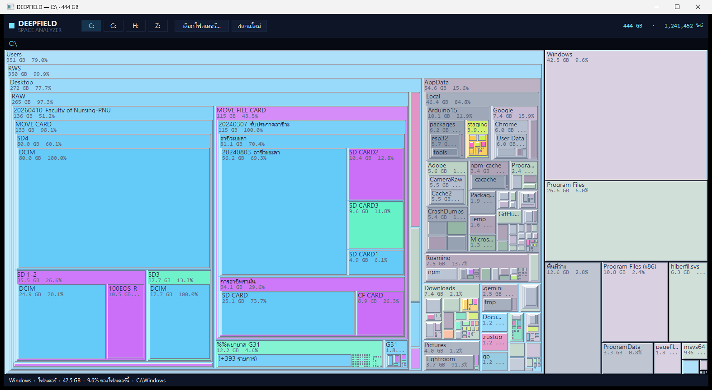

# DEEPFIELD — space analyzer

ตัวช่วยดูว่า "พื้นที่ดิสก์หายไปไหน" แบบเดิม (SpaceMonger) แต่เขียนใหม่ด้วย Go
เป็นไฟล์ .exe เดียวจบ **เปิดหน้าต่างของตัวเองได้ ไม่ต้องพึ่งเบราว์เซอร์**
และกดเลือกได้ทุกไดรฟ์/ทุกโฟลเดอร์ในเครื่อง



## ชื่อ
DEEPFIELD = "Hubble Deep Field" ภาพที่มองเห็นกาแล็กซีทุกจุดในความมืด
→ โปรแกรมนี้เห็นทุกไบต์ในดิสก์ รวมถึงของที่ซ่อนในโฟลเดอร์ลึก ๆ

## ใช้ยังไง

ดับเบิลคลิก `deepfield.exe` — เปิดหน้าต่างโปรแกรม แล้วเลือกไดรฟ์จากปุ่มด้านบน
(`C:` `G:` `H:` `Z:` … ตัวที่เปิดอยู่จะติดสีฟ้า) หรือกด **เลือกโฟลเดอร์…**
เพื่อเปิด dialog ของ Windows แล้วเลือกโฟลเดอร์อะไรก็ได้

```
deepfield.exe                  เปิดหน้าต่าง สแกนไดรฟ์ที่ exe อยู่ แล้วให้เลือกไดรฟ์อื่นต่อ
deepfield.exe "D:\Games"       เปิดหน้าต่างที่โฟลเดอร์ที่กำหนด
deepfield.exe --web "C:\"      โหมดเดิม: เสิร์ฟหน้าเว็บ (ไม่ต้องมีเบราว์เซอร์ก็ไม่ต้องใช้โหมดนี้)
deepfield.exe top "C:\Users" -n 30     ไล่ไฟล์ใหญ่สุดแบบข้อความ
deepfield.exe scan "C:\" > tree.json   พิมพ์ JSON
```

ในหน้าต่างโปรแกรม: **คลิก** โฟลเดอร์เพื่อซูมเข้า · **Backspace** หรือปุ่ม ↑ ขึ้น ถอยออก
· **F5** สแกนใหม่ · ดับเบิลคลิกไฟล์ = เปิดใน Explorer · แถบล่างโชว์ชื่อ/ขนาด/% ของสิ่งที่ชี้อยู่


## ทำไมเร็ว

| จุดสำคัญ | ผล |
|---|---|
| เรียก `FindFirstFileW` / `FindNextFileW` ตรงผ่าน `syscall` | ได้ขนาดไฟล์จาก directory enumeration เลย — ไม่ต้อง `stat()` เพิ่มอีกครั้งต่อไฟล์ |
| worker pool แบบ bounded | CLI ใช้ CPU×6, GUI ใช้ CPU×2 เพื่อเหลือ CPU ให้ message loop ไม่ค้างเป็น "(Not Responding)" |
| ยิง Syscall แบบขนานบน SSD/NVMe | อ่าน metadata หลายพันไฟล์พร้อมกัน |
| path แบบ `\\?\` | ไฟล์ path ยาวเกิน 260 ตัวอักษรก็ยังสแกนได้ |
| แยกขนาด/หมวดด้วย Go ไม่ใช่ JS | treemap เป็นแสนโหนดยังลื่น |

## หน้าต่างโปรแกรมเขียนด้วยอะไร

Win32 API ตรง ๆ ผ่าน `syscall` (user32/gdi32) — ไม่มี CGO ไม่ต้องมี MSVC ไม่ต้องมี
Electron/WebView: วาด toolbar, breadcrumb, treemap และ status bar ลง memory DC
แล้ว BitBlt ขึ้นจอ (กันภาพกระพริบ) treemap ใช้สูตร squarified

## ข้อจำกัดที่รู้อยู่

- GUI เป็น Windows เท่านั้น (build สำหรับ OS อื่นจะตกไปใช้โหมดเว็บ `--web`)
- ไม่ตาม junction / symlink (กัน loop และ OneDrive ที่วกกลับ)
- โฟลเดอร์ที่ไม่มีสิทธิ์ (System Volume Information ฯลฯ) ถูกนับเป็น "ข้าม"
- Windows มี hardlink ใน WinSxS — ขนาดรวมจึงอาจมากกว่าพื้นที่จริงบนดิสก์
- UI ตัดรายการยิบย่อยต่อโฟลเดอร์ (เกิน 200 รายการจะรวมเป็น "(+N รายการ)")
- ยังไม่มีฟีเจอร์ลบไฟล์ในโปรแกรม (ตั้งใจ — กันกดพลาด)

## ไฟล์

| ไฟล์ | หน้าที่ |
|---|---|
| `main.go` | CLI, scanner, HTTP server (โหมด `--web`), หมวดไฟล์, prune |
| `gui_windows.go` | หน้าต่าง Win32 + treemap GDI + ปุ่มไดรฟ์ + folder picker |
| `gui_other.go` | OS ที่ไม่มี Win32 → ตกไปโหมดเว็บ |
| `scan_windows.go` | ตัวอ่าน directory ความเร็วสูง (Win32 API) |
| `scan_other.go` | fallback สำหรับ non-Windows |
| `ui.html` | หน้าเว็บ treemap สำหรับโหมด `--web` (embed เข้า .exe) |

build: `go build -trimpath -ldflags "-s -w" -o deepfield.exe .`
(ไฟล์เดียว ทั้ง GUI และ CLI — ดับเบิลคลิก = GUI, ใส่ subcommand = CLI)
