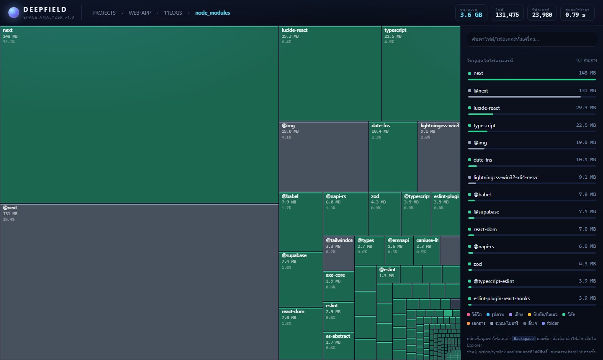

# DEEPFIELD — space analyzer

ตัวช่วยดูว่า "พื้นที่ดิสก์หายไปไหน" แบบเดิม (SpaceMonger) แต่เขียนใหม่ด้วย Go
เป็นไฟล์ .exe เดียวจบ ไม่ต้องลง runtime ไม่ต้องลงอะไรเพิ่ม



## ชื่อ
DEEPFIELD = "Hubble Deep Field" ภาพที่มองเห็นกาแล็กซีทุกจุดในความมืด
→ โปรแกรมนี้เห็นทุกไบต์ในดิสก์ รวมถึงของที่ซ่อนในโฟลเดอร์ลึก ๆ

## ใช้ยังไง

```
deepfield.exe                  สแกนโฟลเดอร์ปัจจุบัน แล้วเปิดหน้าเว็บ
deepfield.exe "C:\"            สแกนไดรฟ์ C
deepfield.exe "D:\Games" --port 7799 --no-open
deepfield.exe top "C:\Users" -n 30     ไล่ไฟล์ใหญ่สุดแบบข้อความ
deepfield.exe scan "C:\" > tree.json   พิมพ์ JSON
```

หรือวาง `deepfield.exe` ไว้ที่ไหนก็ได้แล้วเรียกจาก path นั้นตรง ๆ (ไม่ต้องติดตั้ง)

หน้าเว็บ: คลิกเพื่อซูมเข้าโฟลเดอร์ · Backspace ถอยขึ้น · ดับเบิลคลิกไฟล์ = เปิดใน Explorer
ช่องค้นหาค้นทั้ง tree ที่สแกนไว้ · เปิดลึกตรงโฟลเดอร์ได้ด้วย `/#WEB-APP/11LOGS` (ใส่ hash ต่อท้าย URL)

## ทำไมเร็ว

| จุดสำคัญ | ผล |
|---|---|
| เรียก `FindFirstFileW` / `FindNextFileW` ตรงผ่าน `syscall` | ได้ขนาดไฟล์จาก directory enumeration เลย — ไม่ต้อง `stat()` เพิ่มอีกครั้งต่อไฟล์ |
| worker pool แบบ bounded (CPU×6, สูงสุด 512) | ใช้คิวพร้อมกันหลายโฟลเดอร์ แต่ goroutine ไม่บาน |
| ยิง Syscall แบบขนานบน SSD/NVMe | อ่าน metadata หลายพันไฟล์พร้อมกัน |
| path แบบ `\\?\` | ไฟล์ path ยาวเกิน 260 ตัวอักษรก็ยังสแกนได้ |
| แยกขนาด/หมวดด้วย Go ไม่ใช่ JS | treemap เป็นแสนโหนดยังลื่น |

## ข้อจำกัดที่รู้อยู่

- ไม่ตาม junction / symlink (กัน loop และ OneDrive ที่วกกลับ)
- โฟลเดอร์ที่ไม่มีสิทธิ์ (System Volume Information ฯลฯ) ถูกนับเป็น "ข้าม"
- Windows มี hardlink ใน WinSxS — ขนาดรวมจึงอาจมากกว่าพื้นที่จริงบนดิสก์
- UI ตัดรายการยิบย่อยต่อโฟลเดอร์ (เกิน 160 รายการจะรวมเป็น "(+N รายการ)") เพื่อให้ payload ไม่ใหญ่เกิน
- ยังไม่มีฟีเจอร์ลบไฟล์ในโปรแกรม (ตั้งใจ — กันกดพลาด)

## ไฟล์

| ไฟล์ | หน้าที่ |
|---|---|
| `main.go` | CLI, scanner, HTTP server, หมวดไฟล์, prune |
| `scan_windows.go` | ตัวอ่าน directory ความเร็วสูง (Win32 API) |
| `scan_other.go` | fallback สำหรับ non-Windows |
| `ui.html` | หน้าเว็บ treemap (embed เข้า .exe) |

build: `go build -trimpath -ldflags "-s -w" -o deepfield.exe .`
